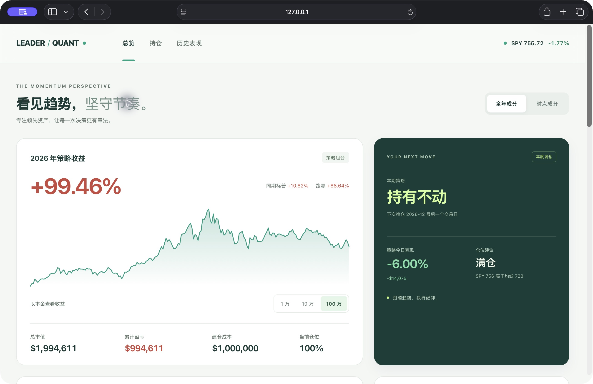
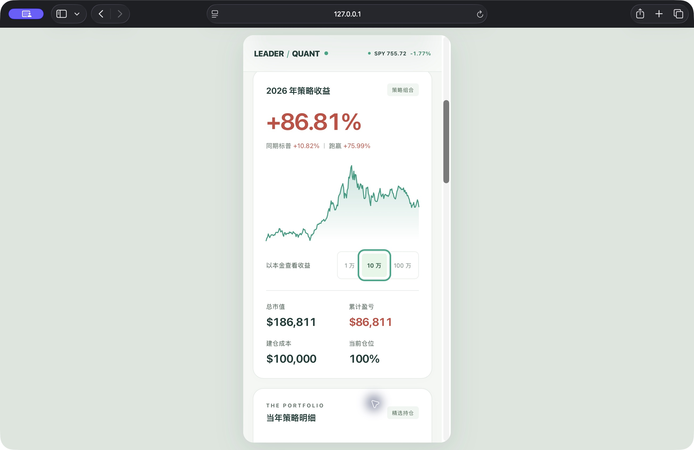
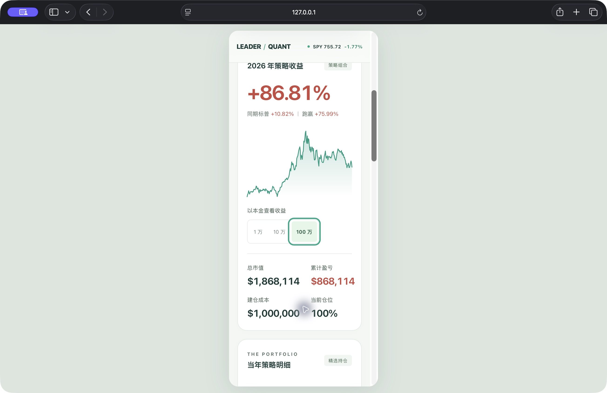

# 主看板视觉与交互审查

范围：既有主看板重构。使用 Product Design audit 工作流，先在 Safari 观察旧页面，再实现并操作本地预览；不调整策略算法、历史结果或在线数据库。截图为本次实际浏览器捕获。

## 发现与修复

1. 总览：旧版整页深色、重复嵌套卡片和大面积金色，主要信息连续向下堆叠。改为暖白底、森林绿策略卡、薄荷绿曲线、珊瑚红正收益；桌面并列呈现收益与行动。保持红涨绿跌及数值正负号。下图为桌面重构效果，状态正常。

   

2. 策略与本金切换：实测全年成分/时点成分均能更新持仓和收益；10 万/100 万切换同步更新账户、市值、持仓和今日盈亏。修复已保存本金造成两个按钮同时高亮，以及本金切换后今日金额未立即更新的问题。增加按钮选中语义和清晰焦点，状态正常。

3. 手机收益卡：通过真实 Safari 中固定 390 CSS 像素的同源 iframe 检查手机布局，使用同一份页面及脚本。修复曲线固定高度导致的小屏控件重叠，按钮至少 44 像素高，数据分两列，文字和金额在检查范围内无遮挡。状态正常。

   

4. 更窄屏幕与大金额：320 CSS 像素下实测 100 万本金，按钮允许换行，大金额保持完整。状态正常。

   

5. 持仓和年度明细：小屏独立横向滚动容器保留全部列，容器可聚焦；已检查可见表格和滚动条。桌面历史导航、年度明细折叠/展开实测通过。真实手机手势滚动仍待真机验收，不以桌面 iframe 替代触摸验收。

## 信息与可访问性

移除主页面采集覆盖率、校验计数和技术更新时间。异常提示改为简短重试提示，详细错误保留在控制台。保留必要的投资研究说明。提高浅色界面的次要文字与收益色对比，提供跳转链接、按钮选中状态、可见键盘焦点和减少动态效果支持。

本次不是完整无障碍认证：未完成屏幕阅读器全流程、真实 iOS/Android 浏览器、旋转屏幕、触摸手势和网络异常的端到端验收。

## 工程验证与交付边界

- 两份 JavaScript 语法检查通过；91 项既有 Python 回归通过；diff 空白检查通过。
- 使用现有构建器复制页面和生成资源版本，新增样式纳入内容哈希；未重新生成金融 JSON。
- 页面源文件在 site_src；docs 中 HTML/CSS/JS 是既有忽略规则下的构建产物，不强制加入版本控制。
- 本次为分支提交及本地可交互预览，尚未合并 main 或部署公开站点；显示的既有历史结果不表示数据收敛已通过。
